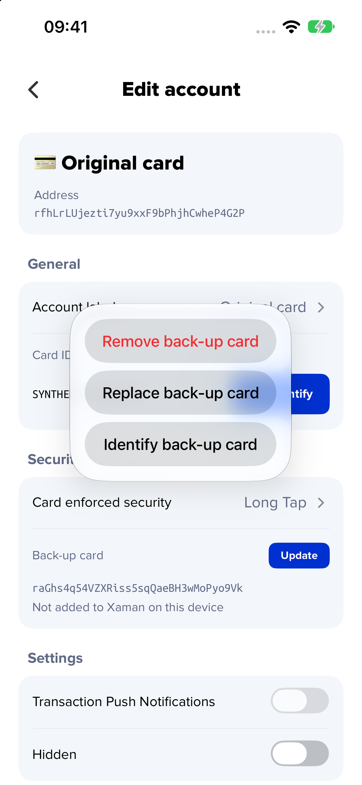
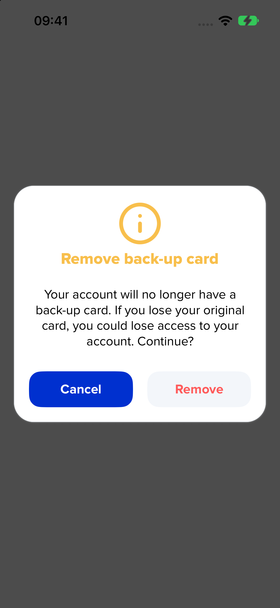
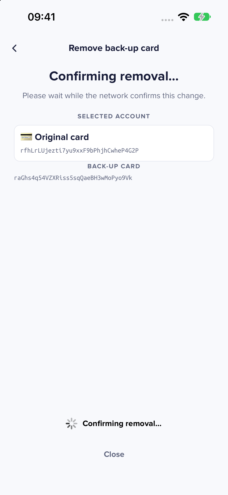
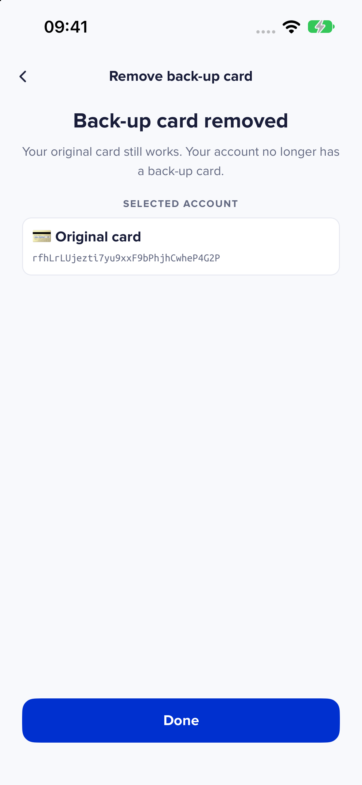
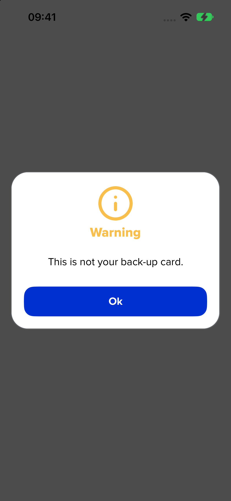
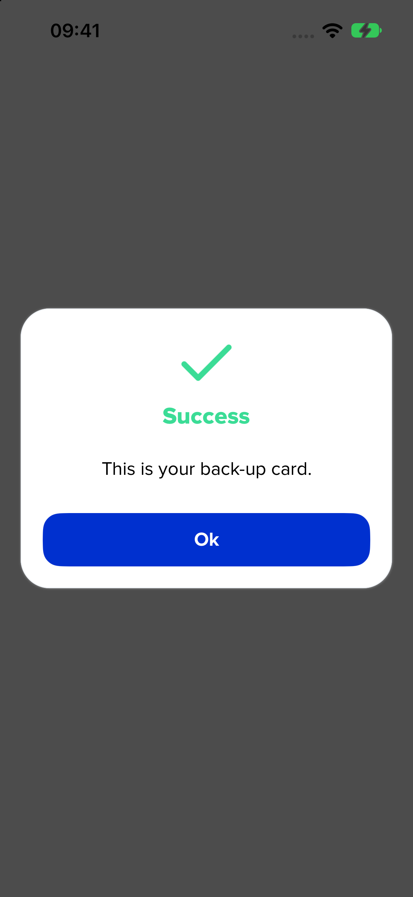
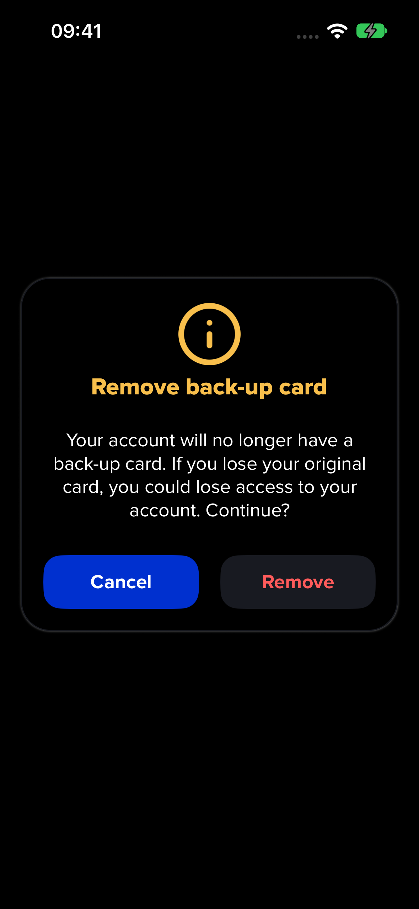
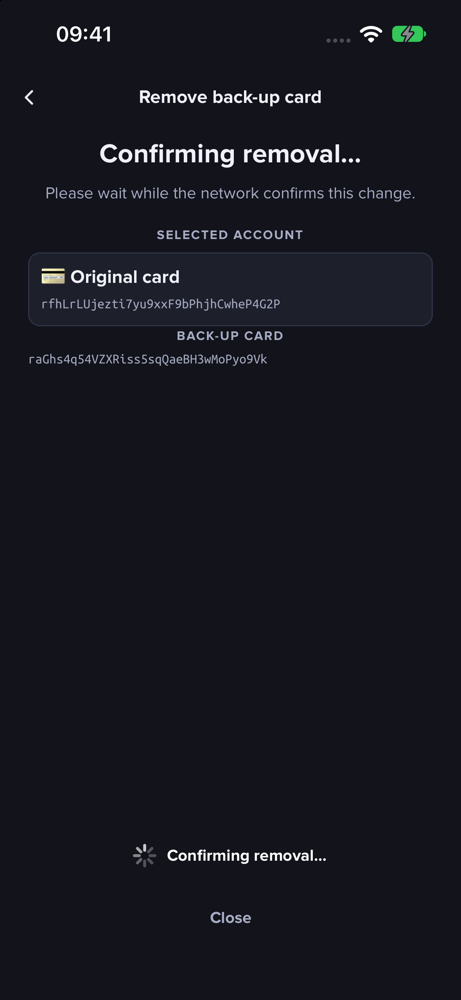

Update opens the existing native action sheet with Remove, Replace and Identify back-up card. Remove uses the formatted warning with primary Cancel and a secondary red Remove action, requires the original card to sign, shows pending confirmation, then hides the removed link. Replace opens the existing setup wizard. Identify compares the scanned derived public key address with the linked back-up address and never creates or imports a card.

The screenshots use production views and callbacks in an optimized native iOS host with synthetic card and ledger responses, in-memory Realm, and the real transaction codec/signature verification. The controls are activated programmatically; these are not physical NFC, funded ledger or native touch E2E results. The sample back-up card is not imported on the device. Light/dark alerts and pending states were visually inspected.

Full Jest: 2,589 tests and 60 snapshots passed; 7 existing tests skipped. Focused management, adapter and UI checks plus normal lint, full TypeScript, locale and endpoint hooks passed. Twelve new messages are localized in all 59 bundles. Every existing translation value, including `moment`, is unchanged.

