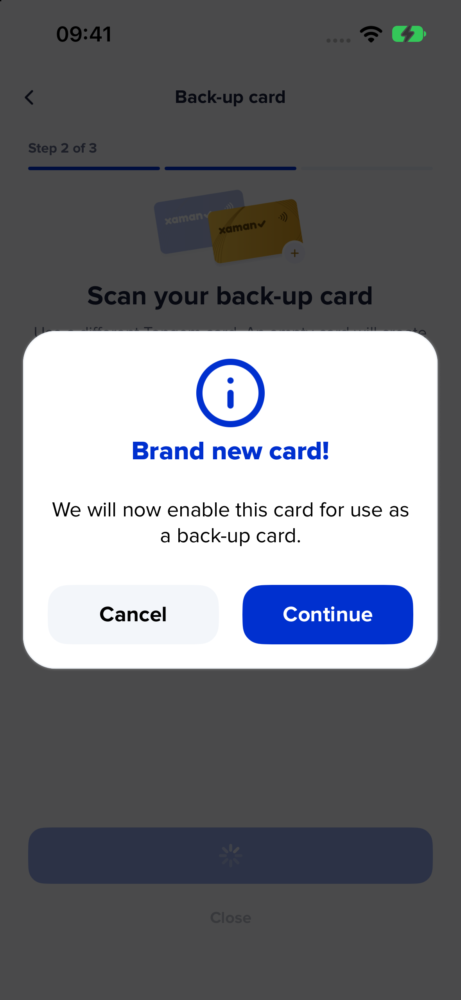
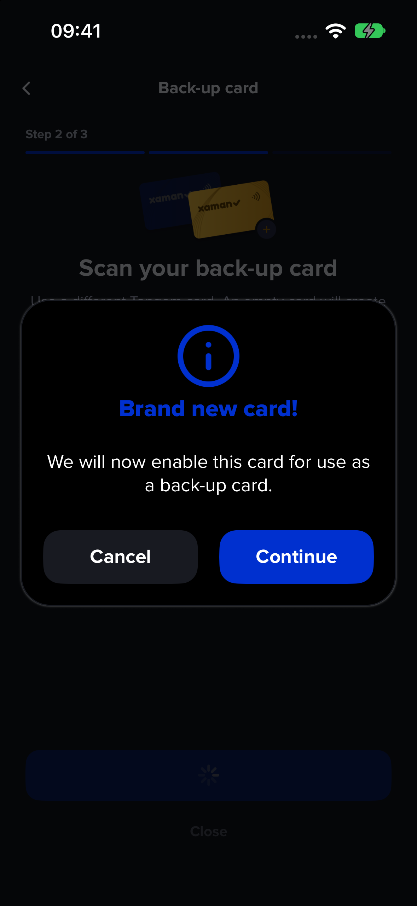

The empty-card alert in Tangem back-up setup now reads:

**Brand new card!**

We will now enable this card for use as a back-up card.

The existing Cancel and Continue actions remain. The dedicated message is localized in all 59 locale bundles; existing translations, including `moment` and the ordinary new-card import message, are unchanged.

These screenshots show the production wizard and formatted alert in a native iOS host with optimized Hermes and synthetic card responses. The real wizard reaches the confirmation through its source-card and empty back-up-card scan stages. They demonstrate the wording and layout in both appearances; no physical NFC scan, native button interaction or ledger submission is claimed for these screenshots. Continue/Cancel behavior is covered by the focused adapter tests.

Validation: 307 focused adapter, back-up locale and translation-integrity tests passed. Normal lint, full TypeScript, locale and endpoint hooks passed. All existing JSON values, including `moment`, were compared with the release base and are unchanged. Full Jest was not repeated for this copy-only change.
