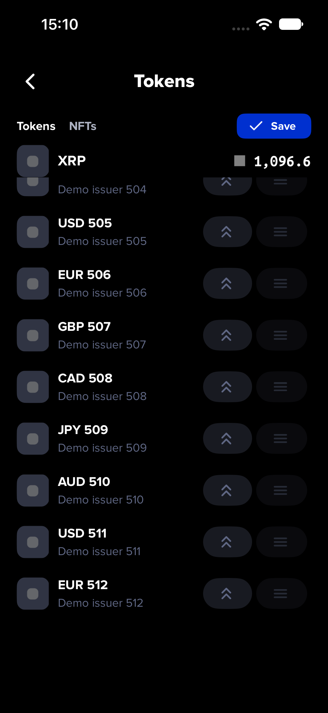
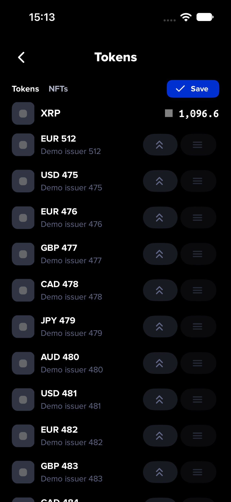
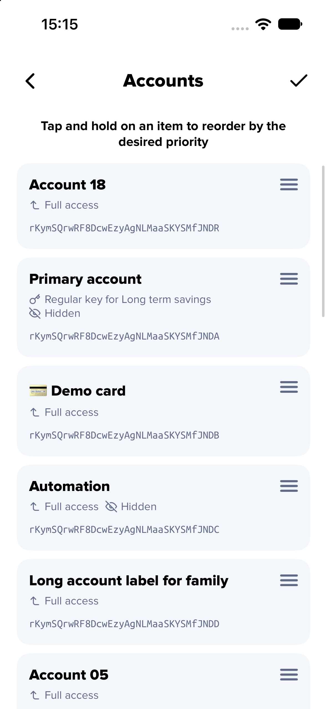

A first drag could lift a row but lose its movement while native measurement or responder handoff was pending. The shared sorter now retains the latest finger position and the initial grab point, follows movement during handoff, and animates only neighbours whose displacement changes.

Native iOS checks used the production TokensList/TokenItem and AccountsList views in an optimized Hermes host, real system touch input, and synthetic offline data. Each first drag started at the bottom with no prior top drag. The timing stress test deliberately delayed native measurement by 800 ms so that the finger could reach the edge before measurement completed; this is a controlled reproduction, not a recording of the physical phone’s failure.

| Check | Release baseline | Fixed |
| --- | --- | --- |
| Last token after first upward drag, 512 rows, delayed measurement | Stayed at position 512 | Moved to position 475 |
| Stationary upward edge hold | Stale initial finger point | Followed the edge, scrolling more than 1,700 points |
| Fresh first-bottom drag with ordinary measurement timing | Separate baseline control passed | Passed |
| 512-token membership, intervening order and explicit Save | — | Passed; no writes before Save |
| First bottom-to-top drag, 18 variable-height accounts | — | Passed, last account reached first position |
| One-neighbour crossing in a 200-row unit check | 199 native animations | 1 native animation |

The accounts and token paths share this fix. Cancellation, backgrounding, data/context changes, native-asset positioning and existing Save/Move to top checks remain covered. Full Jest: 2,603 tests and 60 snapshots passed, with 7 existing skipped tests. All 43 focused checks and normal lint/full TypeScript/locale/endpoint hooks passed. These screenshots contain synthetic data; the physical phone’s accounts/token order were not changed for testing. No Android native/E2E run is claimed for this follow-up.

